# Visual Guide — *From Copilot to Colleague*

A complete visual companion to the book **From Copilot to Colleague: How AI Engineering Turns Models into Dependable Systems**.

Fourteen diagrams: **four** that map the book and the project that produces it, and **ten** that open each chapter with a concrete *before → after*.

Every diagram is a hand-built [Excalidraw](https://excalidraw.com) file (`.excalidraw`, fully editable) rendered to PNG. They are designed to **argue visually** — each shape mirrors the concept it represents, not just label a box.

> The governing thesis: *Models create possibility. Scaffolding creates trust. Organizations decide whether that trust compounds.*

---

## Part I — The Book at a Glance

Four diagrams for the whole project: its argument, how it is made, its core thesis, and its evidence base.

### 1 · The Argument Spine

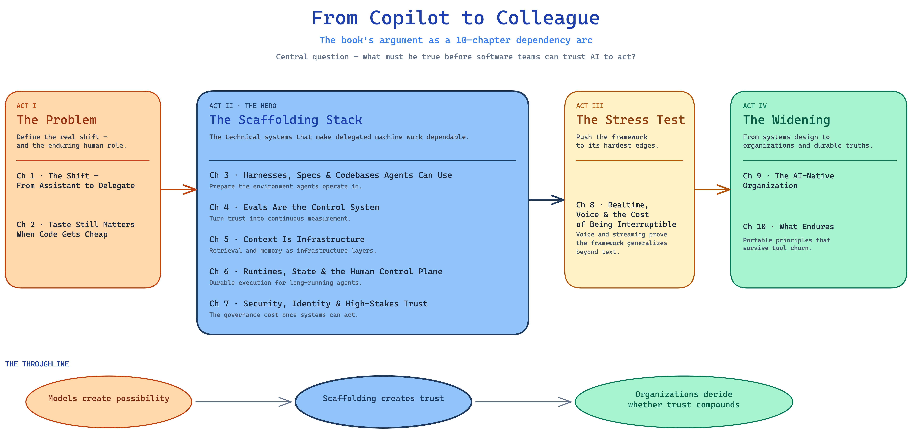

The ten chapters as a **four-act dependency arc** — the Problem (ch 1–2), the Scaffolding Stack (ch 3–7), the Stress Test (ch 8), and the Widening (ch 9–10). It shows the book is an argument with a shape, not a survey, and carries the throughline from possibility to compounding trust.

### 2 · The Autoresearch Knowledge Machine

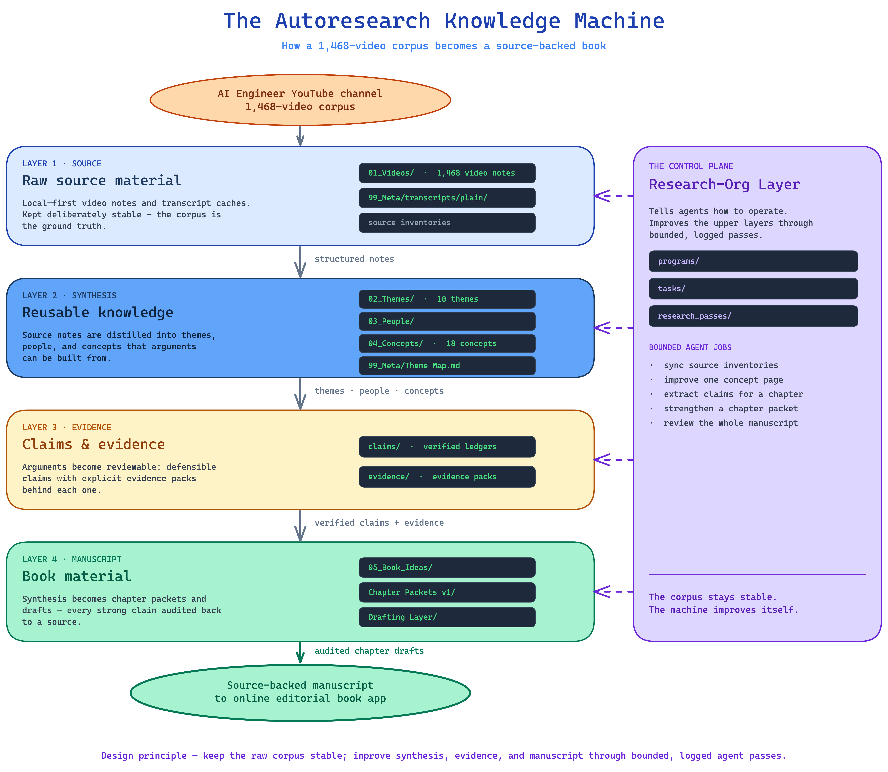

How a 1,468-video corpus becomes a source-backed book: a five-layer pipeline — **Source → Synthesis → Evidence → Manuscript** — governed by a Research-Org control plane that improves the upper layers through bounded, logged agent passes. Real directory names are shown as evidence.

### 3 · The Scaffolding Stack

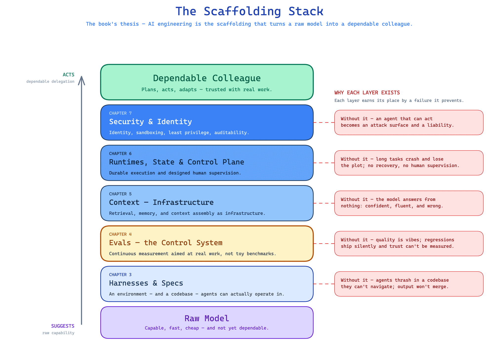

The book's central thesis in one picture: a raw model is capable but not dependable. Five engineered layers wrap it — harnesses, evals, context, runtimes, security — and each one earns its place by a specific failure it prevents.

### 4 · Theme & Corpus Map

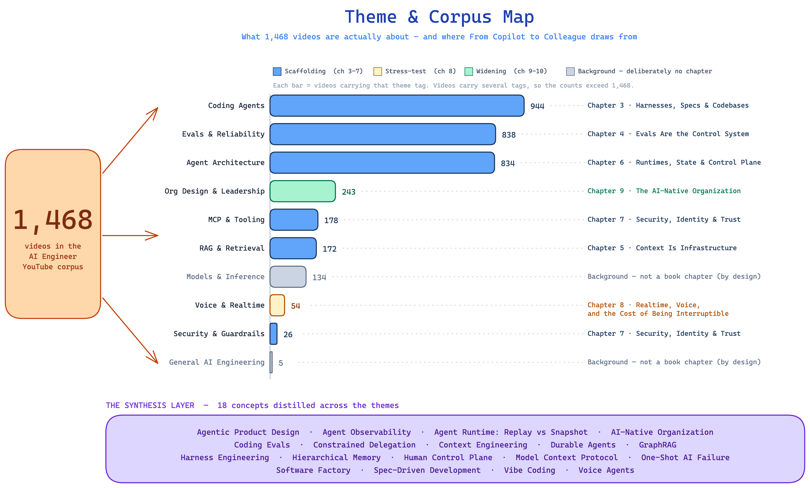

What 1,468 videos are actually about: ten themes sized by corpus count, colour-coded by the book act they feed, each mapped to its chapter — including the honest editorial call that *Models & Inference* is deliberately background, not a chapter.

The counts move as the corpus grows. `diagrams/_update_corpus_counts.py` derives them from `99_Meta/Corpus Stats.md` and rewrites this diagram, the pipeline diagram, and the methodology map.

`--check` is a CI gate. It fails when the chart's **shape** is wrong — a row labelled with another theme's chapter, a bar wearing another act's colour, or a ranking out of order by more than the tolerance — and when the headline count falls more than 5% behind. A swap between two near-tied themes is lag, not shape: *Evals & Reliability* and *Agent Architecture* sit four notes apart, and a gate that failed every time they traded places would fire on ordinary ingest nights until someone stopped reading it.

---

## Part II — Chapter by Chapter

Each chapter diagram contrasts **the naive way** — how AI work goes wrong today — with **the engineered way** — the best practice the chapter argues for. Both sides carry a concrete code or config sample, and the chapter's four strongest claims sit underneath.

### Chapter 1 · The Shift: From Assistant to Delegate

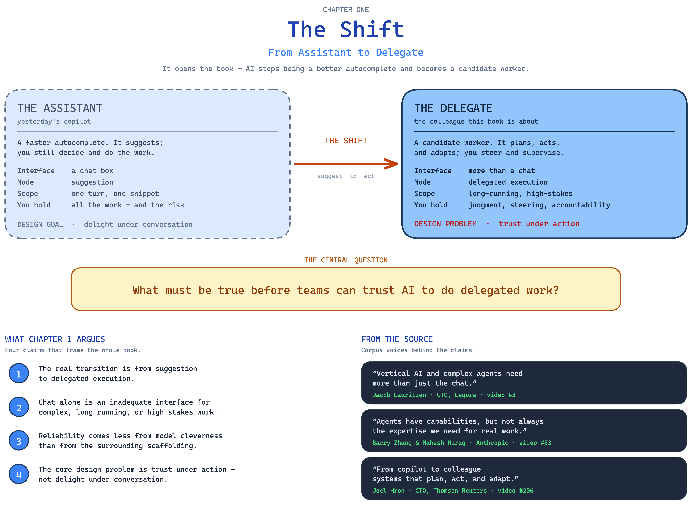

The book's opening move: AI stops being a better autocomplete and becomes a candidate worker. Assistant vs delegate, side by side — and the central question the whole book answers: *what must be true before teams can trust AI to act?*

### Chapter 2 · Taste Still Matters When Code Gets Cheap

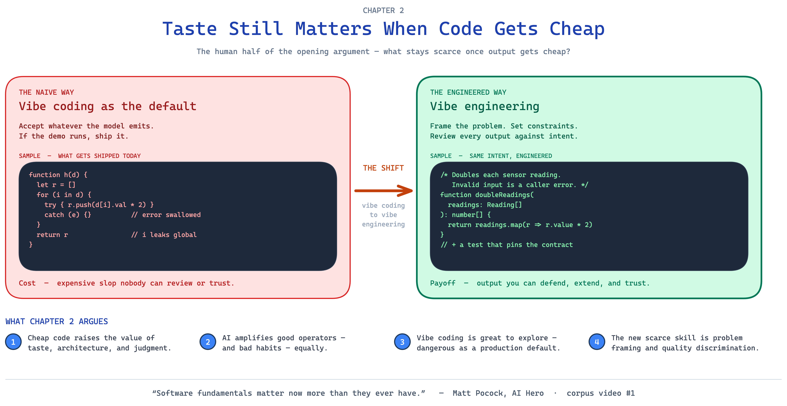

When generation gets cheap, judgment gets scarce. *Vibe coding* (ship whatever runs) vs *vibe engineering* (frame, constrain, review) — shown with the same intent written two ways.

### Chapter 3 · Harnesses, Specs & Codebases Agents Can Use

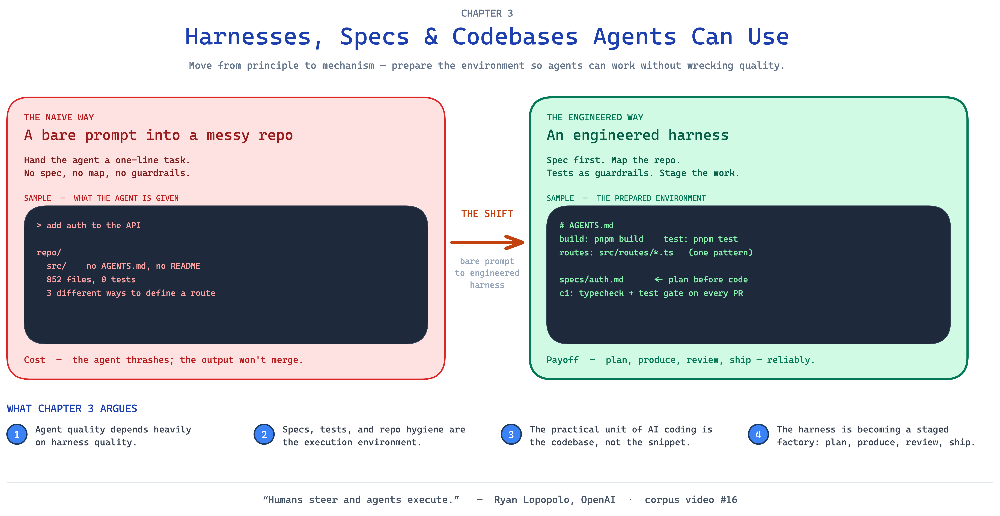

Agent quality depends on harness quality. A bare prompt into a messy repo vs a prepared environment — `AGENTS.md`, specs, tests as guardrails, a staged plan → produce → review → ship loop.

### Chapter 4 · Evals Are the Control System


Trust has to be measured. Demo vibes and a leaderboard score vs an operational eval loop — human-seeded cases, task-level scoring, and production traces that feed the next generation of evals.

### Chapter 5 · Context Is Infrastructure

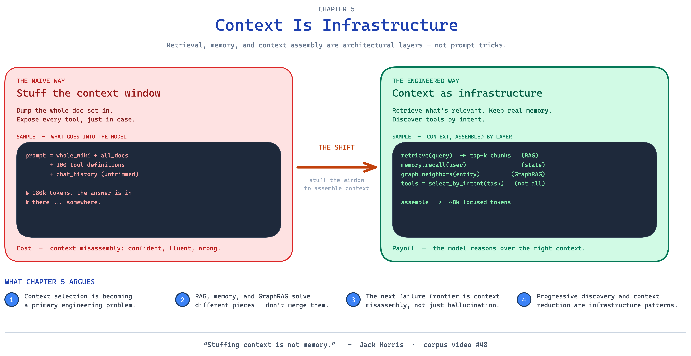

Prompt quality is downstream of information architecture. Stuffing 180k tokens into the window vs assembling context by layer — RAG, memory, GraphRAG, intent-aware tool selection.

### Chapter 6 · Runtimes, State & the Human Control Plane

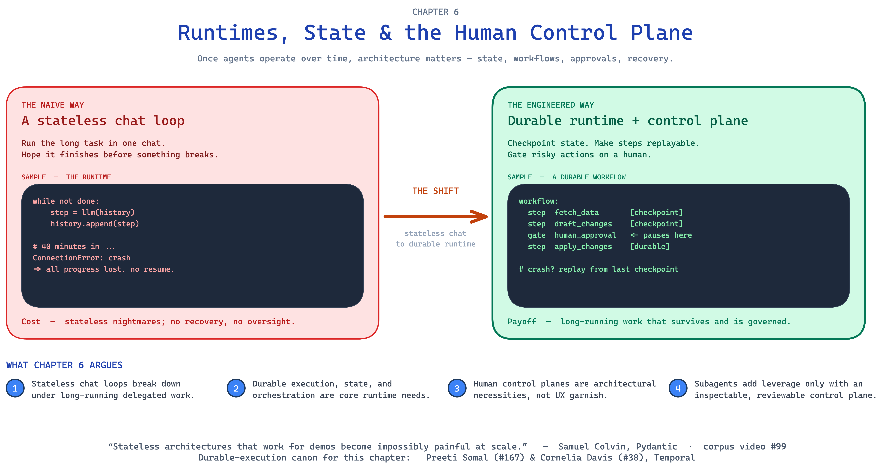

Long-running work needs architecture. A stateless chat loop that loses everything on a crash vs a durable runtime with checkpoints, replay, and a human approval gate.

### Chapter 7 · Security, Identity & High-Stakes Trust

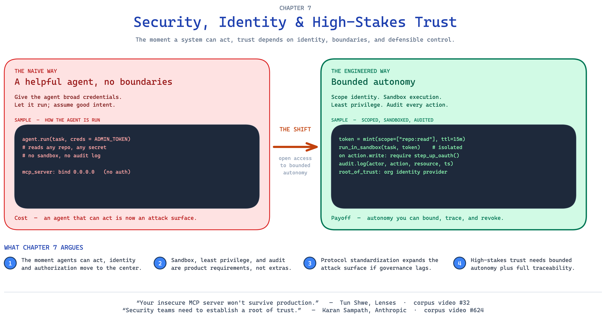

The moment a system can act, it becomes an attack surface. A helpful agent with admin credentials vs bounded autonomy — scoped identity, sandboxing, least privilege, an audit trail, a root of trust.

### Chapter 8 · Realtime, Voice, and the Cost of Being Interruptible

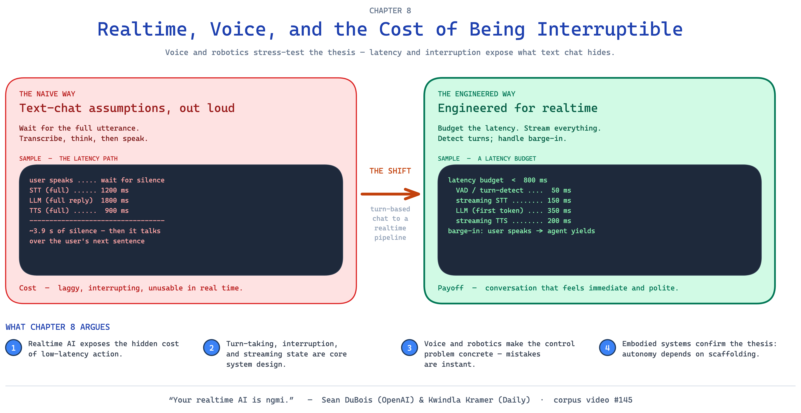

Voice and robotics stress-test the thesis. Text-chat assumptions out loud (≈3.9 s of lag) vs a realtime pipeline with a sub-800 ms latency budget, streaming, turn detection, and barge-in.

### Chapter 9 · The AI-Native Organization

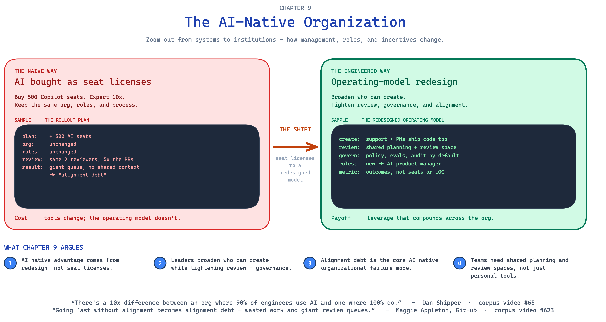

The deepest gains are organizational. Buying 500 AI seats and changing nothing else vs an operating-model redesign — broaden who can create, tighten review and governance, pay down *alignment debt*.

### Chapter 10 · What Endures

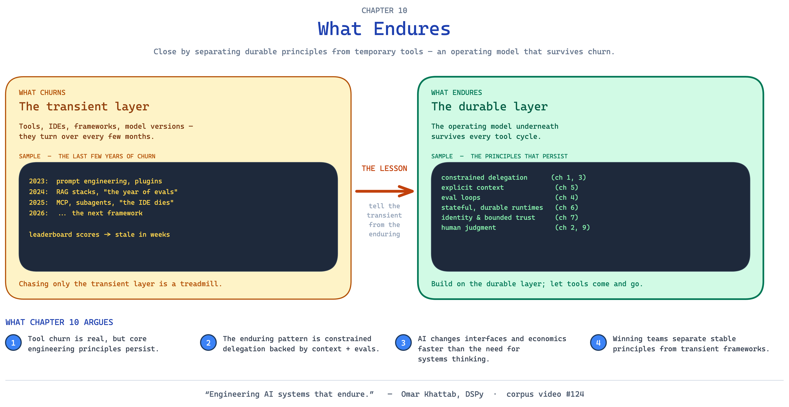

The close: separate the tools that churn every few months from the operating model that survives them — constrained delegation, explicit context, eval loops, durable runtimes, bounded trust, and human judgment.

---

## How these were made

- **Built with** the `excalidraw-diagram` skill — diagrams that argue visually, hand-authored as Excalidraw JSON and validated through a render-and-review loop.
- **Sourced from** the book knowledge base: chapter packets, the source-backed outline, the theme map, and the project architecture docs.
- **To edit:** open any `.excalidraw` file at [excalidraw.com](https://excalidraw.com) (or in the Excalidraw VS Code / Obsidian plugin).
- **To re-render to PNG:**
  ```bash
  npx @excalidraw-skill-pack/render <path-to-file.excalidraw>
  ```

## Style & templates

The book's diagram identity is documented in **[`STYLE.md`](STYLE.md)** — palette mapping, the blue→green signature mark, title system, citation style, and defensibility rules.

Reusable skeletons live in **[`templates/`](templates/)** — copy one, fill the `[bracketed]` placeholders, render:

- `inline-figure.excalidraw` — a small single-idea section figure
- `concept-card.excalidraw` — a standalone concept explainer
- `chapter-card.excalidraw` — a full-page before → after chapter diagram
- `layered-stack.excalidraw` — "X is built of layers"
- `flow-pipeline.excalidraw` — a process or pipeline
- `relationship-map.excalidraw` — nodes and edges (graphs, maps)

## Files

| # | Diagram | Source | Render |
|---|---------|--------|--------|
| 1 | The Argument Spine | `01-book-argument-spine.excalidraw` | `01-book-argument-spine.png` |
| 2 | The Autoresearch Knowledge Machine | `02-autoresearch-machine.excalidraw` | `02-autoresearch-machine.png` |
| 3 | The Scaffolding Stack | `03-scaffolding-stack.excalidraw` | `03-scaffolding-stack.png` |
| 4 | Theme & Corpus Map | `04-theme-corpus-map.excalidraw` | `04-theme-corpus-map.png` |
| 5 | Chapter 1 — The Shift | `05-chapter1-the-shift.excalidraw` | `05-chapter1-the-shift.png` |
| 6 | Chapter 2 — Taste | `06-chapter2-taste.excalidraw` | `06-chapter2-taste.png` |
| 7 | Chapter 3 — Harnesses | `07-chapter3-harnesses.excalidraw` | `07-chapter3-harnesses.png` |
| 8 | Chapter 4 — Evals | `08-chapter4-evals.excalidraw` | `08-chapter4-evals.png` |
| 9 | Chapter 5 — Context | `09-chapter5-context.excalidraw` | `09-chapter5-context.png` |
| 10 | Chapter 6 — Runtimes | `10-chapter6-runtimes.excalidraw` | `10-chapter6-runtimes.png` |
| 11 | Chapter 7 — Security | `11-chapter7-security.excalidraw` | `11-chapter7-security.png` |
| 12 | Chapter 8 — Realtime | `12-chapter8-realtime.excalidraw` | `12-chapter8-realtime.png` |
| 13 | Chapter 9 — AI-Native Org | `13-chapter9-ai-native-org.excalidraw` | `13-chapter9-ai-native-org.png` |
| 14 | Chapter 10 — What Endures | `14-chapter10-what-endures.excalidraw` | `14-chapter10-what-endures.png` |

---

## Interface

This directory also holds the Python scripts that write or update diagram
sources. Each one runs as a script from the repo root. None of them is a
library.

### Subdirectories with contracts

- [`covers/`](./covers/README.md) - `_grow_specimen.py` grows the three book
  cover plates from `01_Videos/`, and its `--check` gate.
- [`dividers/`](./dividers/README.md) - `_gen_dividers.py` writes the four
  act divider files.

### `_update_corpus_counts.py`

Rewrites the corpus counts in three diagram sources from
`99_Meta/Corpus Stats.md`.

- `python3 diagrams/_update_corpus_counts.py` rewrites the sources.
  `--check` writes nothing and exits 1 on failure. `--tolerance` sets the lag
  limit (default `0.05`).
- `read_stats(stats_path=None) -> (total, themes)`: parses the
  `- Total notes: N` line and the `- Name: N` lines under `## Theme counts`.
- `update_theme_map(path, total, themes)`: rewrites `04-theme-corpus-map`
  (subtitle, headline count, chart note, ten rows).
- `update_corpus_mentions(path, total, replacements)`: rewrites the corpus
  size in `02-autoresearch-machine` and `maps/02-methodology-deep-dive`.
- `printed_rows(path)`, `stated_total(path)`: read what the theme map prints
  now.
- `structural_problems(path, themes, tolerance)`, `verdict(...)`: decide if
  drift fails the gate.
- `set_field`, `write_doc`, `by_id`: element edit and write helpers.
- Constants: `THEME_MAP` (theme -> chapter label, act), `ACTS` (act ->
  palette), `BACKGROUND_LABEL`, `BAR_X`, `BAR_MAX_W`, `COUNT_GAP`,
  `MIN_BAR_W`.

### Inline gap-figure generators (`_gen_*gap_diagrams.py`)

Eleven scripts write inline figures into `inline/`. Each one holds its own
copy of the same small drawing DSL: `base`, `T`, `box`, `ln`, `arr`, `save`,
and in most files `header` and `node`. The copies differ:

- `_gen_ch03_gap_diagrams.py` adds `cite()` and the `CODE`, `PATH`,
  `CODE_RED` inks.
- `_gen_ch04_gap_diagrams.py` uses `header4` and `footer4` instead of
  `header`.
- `_gen_ch05_gap_diagrams.py` defines no `node`.
- In `ch04`, `ch06`, `ch07` and `ch10`, `box` takes an `ss` (stroke style)
  argument.

Running a script calls every figure function in its `__main__` block.

| Script | Figure functions | Files written to `inline/` |
|---|---|---|
| `_gen_gap_diagrams.py` | `ch01_fig4`, `ch05_fig4`, `ch05_fig5`, `ch06_fig4`, `ch07_fig4`, `ch08_fig4`, `ch08_fig5`, `ch09_fig4` | `ch01-fig4-failure-surface-stretches`, `ch05-fig4-misassembly-vs-hallucination`, `ch05-fig5-retrieval-is-four-jobs`, `ch06-fig4-agency-dial`, `ch07-fig4-enterprise-mcp-gateway`, `ch08-fig4-half-duplex-ceiling`, `ch08-fig5-latency-masking`, `ch09-fig4-review-bottleneck` |
| `_gen_ch01_gap_diagrams.py` | `ch01_fig5` to `ch01_fig8` | `ch01-fig5-capability-vs-expertise`, `ch01-fig6-two-recurring-cases`, `ch01-fig7-make-standards-explicit`, `ch01-fig8-scattered-to-discipline` |
| `_gen_ch02_gap_diagrams.py` | `ch02_fig4` to `ch02_fig10` | `ch02-fig4-comprehension-debt`, `ch02-fig5-mode-switch-cost-of-wrong`, `ch02-fig6-framing-gate`, `ch02-fig7-review-war-on-slop`, `ch02-fig8-constraints-are-care`, `ch02-fig9-adults-in-the-room`, `ch02-fig10-production-to-direction` |
| `_gen_ch03_gap_diagrams.py` | `ch03_fig4` to `ch03_fig8` | `ch03-fig4-slop-era-tuesday`, `ch03-fig5-unstated-decisions`, `ch03-fig6-agent-ready-checklist`, `ch03-fig7-subagents-specialization`, `ch03-fig8-environment-design` |
| `_gen_ch04_gap_diagrams.py` | `ch04_fig4` to `ch04_fig10` | `ch04-fig4-admin-override-regression`, `ch04-fig5-revert-and-reproduce`, `ch04-fig6-layers-of-evidence`, `ch04-fig7-weight-by-consequence`, `ch04-fig8-externalize-judgment`, `ch04-fig9-organizational-control`, `ch04-fig10-control-system` |
| `_gen_ch05_gap_diagrams.py` | `ch05_fig6` to `ch05_fig9` | `ch05-fig6-misranked-matter-note`, `ch05-fig7-cost-is-mostly-input`, `ch05-fig8-acceptance-test`, `ch05-fig9-amplification-rule` |
| `_gen_ch06_gap_diagrams.py` | `fig5_factory_os`, `fig6_workflows_with_state`, `fig7_history_is_execution`, `fig8_replay_vs_snapshot`, `fig9_two_scarce_resources`, `fig10_legacy_as_runtime`, `fig11_observability`, `fig12_isolation_rungs`, `fig13_coordination_substitutes` | `ch06-fig5-factory-operating-system`, `ch06-fig6-workflows-with-state`, `ch06-fig7-history-is-execution`, `ch06-fig8-replay-vs-snapshot`, `ch06-fig9-two-scarce-resources`, `ch06-fig10-legacy-as-runtime`, `ch06-fig11-observability-control-plane`, `ch06-fig12-isolation-rungs`, `ch06-fig13-coordination-substitutes` |
| `_gen_ch07_gap_diagrams.py` | `ch07_fig5` to `ch07_fig9` | `ch07-fig5-four-control-baseline`, `ch07-fig6-default-permission-table`, `ch07-fig7-disputed-filing-reconstruction`, `ch07-fig8-tuned-autonomy`, `ch07-fig9-deserved-trust` |
| `_gen_ch08_gap_diagrams.py` | `ch08_fig6` to `ch08_fig9` | `ch08-fig6-realtime-stress-test`, `ch08-fig7-three-failure-modes`, `ch08-fig8-false-confidence-trap`, `ch08-fig9-forgiveness-gradient` |
| `_gen_ch09_gap_diagrams.py` | `ch09_fig5` to `ch09_fig9` | `ch09-fig5-monday-morning`, `ch09-fig6-seats-vs-approval-path`, `ch09-fig7-throughput-not-velocity`, `ch09-fig8-consensus-review`, `ch09-fig9-accountability-owner` |
| `_gen_ch10_gap_diagrams.py` | `ch10_fig4` | `ch10-fig4-situated-intelligence` |

Every file in the last column ends in `.excalidraw` and exists in `inline/`.

## Invariants

- `_update_corpus_counts.py:update_theme_map` exits with an error if a theme
  in the stats file has no entry in `THEME_MAP`, or if there are more than 10
  themes. The chart has exactly 10 rows.
- The script finds elements by id. These ids must exist:
  `04-theme-corpus-map`: `t_sub`, `corpus_n`, `chart_note`, and `nm1`..`nm10`,
  `ct1`..`ct10`, `cl1`..`cl10`, `bar1`..`bar10`.
  `02-autoresearch-machine`: `t_sub`, `input_t`, `p_l1_1t`.
  `maps/02-methodology-deep-dive`: `input_t`, `p_l1a_t`.
- A theme map row is five elements that must agree: bar fill and stroke,
  name, count, and chapter label, all from the row's `ACTS` palette.
- `set_field` also writes `text` into `originalText`, so the two never
  disagree.
- `verdict` fails on any structural problem at any tolerance. It fails on an
  unreadable headline count. It fails on lag only when the printed total is
  more than `--tolerance` behind.
- `structural_problems` counts a row swap as structural only when the lower
  row's count exceeds the upper row's by more than the tolerance.
- A second run of `_update_corpus_counts.py` against an unchanged stats file
  writes nothing.
- Each gap generator takes element ids from a fixed counter `_s` and sets
  `updated=1`. A rerun with unchanged code writes the same files. Ids are
  unique within one file, not across files.
- No two generators write the same `inline/` file
  (`grep -ho 'save("[^"]*"' diagrams/_gen_*.py | sort | uniq -d` prints
  nothing).

## Side Effects

- `_update_corpus_counts.py` reads `99_Meta/Corpus Stats.md`. Without
  `--check`, it rewrites `04-theme-corpus-map.excalidraw`,
  `02-autoresearch-machine.excalidraw` and
  `maps/02-methodology-deep-dive.excalidraw` when they drift (UTF-8,
  2-space indent, `ensure_ascii=False`). It does not render PNGs. Run
  `scripts/sync-diagrams.sh` after it.
- `_update_corpus_counts.py --check` copies the three sources to a temporary
  directory, edits the copies only, and deletes them.
- Each `_gen_*gap_diagrams.py` overwrites its files in `inline/` and prints
  `wrote inline/<name>`. It writes with `open(..., "w")` and no `encoding=`.
- No script at this level renders PNGs. Only `covers/_grow_specimen.py`
  renders, and only its own plates.

## Verification

From the repo root:

- Run: `python3 scripts/test_update_corpus_counts.py`
- Run: `python3 scripts/test_check_diagram_sync.py`
- Run: `python3 scripts/test_grow_specimen.py` (for `covers/`)
- Gates in `.github/workflows/diagrams-check.yml`:
  `python3 scripts/check_diagram_sync.py`,
  `python3 diagrams/_update_corpus_counts.py --check`,
  `python3 diagrams/covers/_grow_specimen.py --check`.
- Lint: `.github/workflows/script-tests.yml` runs `ruff check` on
  `diagrams/_update_corpus_counts.py` and `diagrams/covers/_grow_specimen.py`
  only. The `_gen_*.py` scripts are not linted and have no tests.
